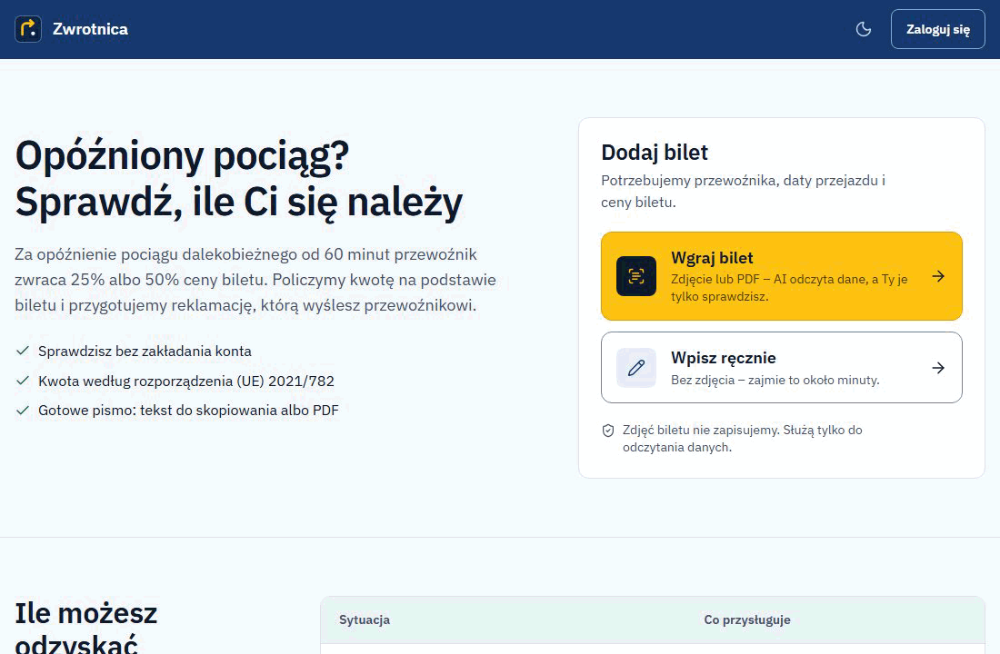
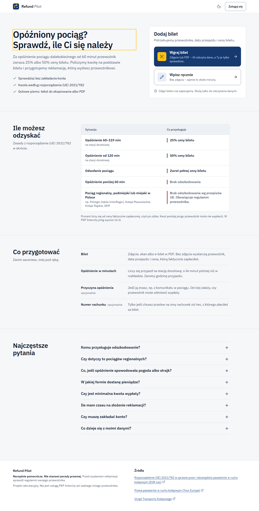
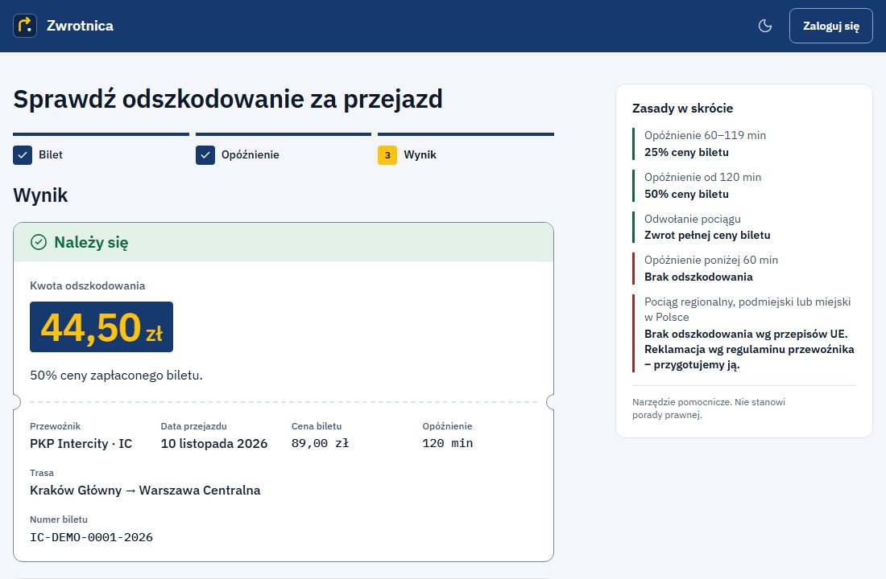
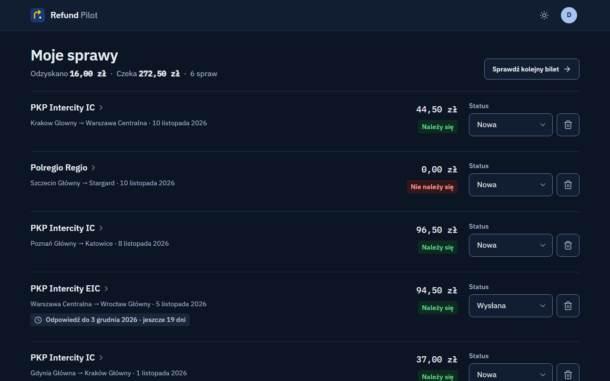
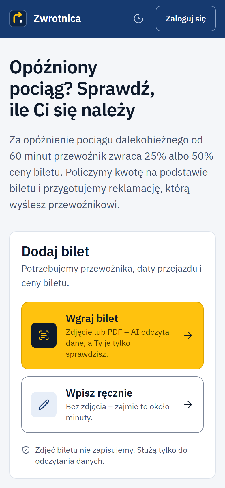
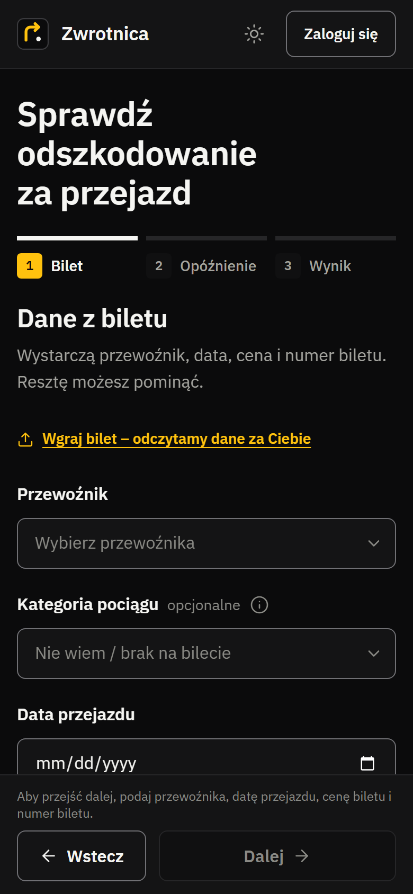

# Refund Pilot

Pociąg dalekobieżny spóźnił się ponad godzinę? Według rozporządzenia (UE) 2021/782 pasażerowi należy się wtedy 25% albo 50% ceny biletu. Mało kto o tym wie, a jeszcze mniej osób chce pisać reklamację. **Refund Pilot** w trzech krokach (Bilet → Opóźnienie → Wynik) mówi uczciwie, czy coś się należy, ile dokładnie, i przygotowuje gotowe pismo reklamacyjne. AI czyta bilet i pisze pismo, a o tym, co się należy, i o kwotach decyduje zwykły kod.



> Narzędzie pomocnicze – nie stanowi porady prawnej.

## Spis treści

- [Co robi aplikacja](#co-robi-aplikacja)
- [Zrzuty ekranu](#zrzuty-ekranu)
- [Architektura i stack](#architektura-i-stack)
- [Ciekawsze rozwiązania](#ciekawsze-rozwiązania)
- [Uruchomienie lokalne](#uruchomienie-lokalne)
- [API](#api)
- [Jak korzystałem z narzędzi AI](#jak-korzystałem-z-narzędzi-ai)
- [Ograniczenia i dalszy rozwój](#ograniczenia-i-dalszy-rozwój)
- [Struktura repozytorium](#struktura-repozytorium)

## Co robi aplikacja

- **Odczyt biletu przez AI.** Zdjęcie (aparat lub galeria w telefonie) albo plik, także PDF e-biletu, do 4 plików po 5 MB. Gemini wypełnia pola: przewoźnik, kategoria, stacje, data, cena, numer biletu. Użytkownik sprawdza wynik, a pola, których AI nie odczytało, są wyraźnie oznaczone do uzupełnienia. Pliki są przetwarzane w pamięci i nigdzie nie są zapisywane.
- **Ścieżka ręczna.** Te same pola wpisuje się samemu. Przewoźnik i kategoria to listy wyboru z opcją „Inny”. Ta ścieżka działa także bez klucza AI.
- **Krok opóźnienia.** Liczba minut opóźnienia na stacji docelowej albo odwołanie pociągu, przyczyna (opcjonalnie, z podpowiedzią ⓘ, która działa myszą, dotykiem i klawiaturą) i zaznaczenie biletu okresowego.
- **Uczciwy werdykt: Należy się / Nie należy się / Do sprawdzenia** z krótkim uzasadnieniem.
  - PKP Intercity (EIP, EIC, IC, TLK) i połączenia międzynarodowe są objęte systemem 25%/50%.
  - Przewoźnicy regionalni, miejscy i podmiejscy (Polregio, Koleje Mazowieckie, Śląskie, Dolnośląskie, Małopolskie, Wielkopolskie, SKM, WKD, ŁKA, Arriva RP) dostają „Nie należy się”, bo Polska wyłącza je z tego systemu. Aplikacja nie pokazuje dla nich błędnej kwoty.
  - InterRegio (prowadzi je Polregio, a nie PKP Intercity) oraz nierozpoznany przewoźnik lub kategoria dostają „Do sprawdzenia”.
- **Zasady kwot:** 60–119 min to 25%, co najmniej 120 min to 50%, odwołanie to 100% ceny faktycznie zapłaconej. Kwoty poniżej minimalnej wypłaty przewoźnika (16 zł) są oznaczone ostrzeżeniem. Bez ceny biletu kwota nie jest zgadywana.
- **Ryzyko siły wyższej.** Gdy przyczyną są pogoda albo osoby na torach, kwota się nie zmienia, ale pojawia się ostrzeżenie o ryzyku odmowy.
- **Bilet okresowy** dostaje „Do sprawdzenia”. Kwota nie jest liczona automatycznie.
- **Forma wypłaty (3 opcje):** zwrot na konto lub kartę użyte do zakupu (domyślnie, bez podawania numeru), przelew na inny rachunek albo bon. Pismo zawiera osobne, konkretne zdanie dla każdej opcji.
- **Pismo reklamacyjne** w dwóch formach: jako tekst (temat e-maila i treść, przyciski „Kopiuj”) albo jako PDF do pobrania. Po wygenerowaniu aplikacja pokazuje listę danych do ręcznego uzupełnienia, np. „Uzupełnij w piśmie: numer rachunku, adres”. Te miejsca są oznaczone w treści nawiasami `[ ]`.
- **Konta użytkowników:** rejestracja e-mailem i hasłem. Profil (imię i nazwisko, adres, rachunek, preferowana forma wypłaty) jest opcjonalny, a **numer rachunku jest szyfrowany w bazie**. Rachunek można też podać jednorazowo w kreatorze, z opcją zapamiętania go na koncie.
- **Lista spraw** ze statusami Nowa → Wysłana → Wypłacona / Odrzucona i licznikiem kwot odzyskanych i oczekujących. Po oznaczeniu sprawy jako wysłanej startuje **odliczanie miesiąca na odpowiedź przewoźnika**. Po terminie aplikacja podpowiada skargę do UTK.
- **Tryb gościa:** odczyt biletu, werdykt i kwota działają bez logowania. Zapis sprawy i pismo wymagają konta. Logowanie pojawia się w miejscu, bez utraty wpisanych danych.
- **Jasny i ciemny motyw** (jeden styl, dwie palety, przełącznik). Projekt **mobile-first**: duże cele dotykowe i przyklejony przycisk akcji na telefonie.

## Zrzuty ekranu

| Strona główna | Wynik | Pismo |
|---|---|---|
|  |  |  |

| Sprawy (ciemny motyw) | Telefon – start | Telefon – ścieżka ręczna (ciemny) |
|---|---|---|
|  |  |  |

Pozostałe zrzuty są w [`docs/screenshots/`](docs/screenshots/).

## Architektura i stack

Osobne projekty: `backend/` (ASP.NET Core, .NET 10) i `frontend/` (React + Vite + TypeScript).

**Backend – warstwy (Clean Architecture w wersji minimum):**

| Projekt | Odpowiedzialność |
|---|---|
| `RefundPilot.Domain` | Reguły bez zależności: `EligibilityService` (kto jest objęty systemem), `CompensationCalculator` (25/50/100%), `CarrierCatalog` (słownik przewoźników i kategorii, jedno źródło prawdy), `Iban` (mod-97), encje i enumy. |
| `RefundPilot.Application` | Serwisy przypadków użycia (`AssessmentService`, `CaseService`, `ExtractionService`, `ComplaintService`, `ProfileService`), DTO, walidacja wejścia (dozwolone znaki per pole, IBAN, data podróży), interfejsy (`IAiClient`, `ICaseRepository`, `IUnitOfWork`…). |
| `RefundPilot.Infrastructure` | EF Core + SQLite, repozytorium, transakcje (`EfUnitOfWork`), seed, `GeminiClient` / `NullAiClient`, szyfrowanie IBAN (`IbanCipher`), PDF (QuestPDF). |
| `RefundPilot.Api` | Chude kontrolery (przyjmują żądanie, wołają serwis, zwracają kod HTTP), konfiguracja: Identity, CORS, rate limiting, ProblemDetails, Swagger. |

- **Dane:** EF Core + SQLite (plik lokalny). Schemat powstaje przy starcie (`EnsureCreated`), a seed tworzy konto demo z 5 fikcyjnymi sprawami. Zapisy obejmujące kilka tabel idą w transakcji, a listy są pobierane bez zapytań w pętlach.
- **Uwierzytelnianie:** ASP.NET Core Identity (`MapIdentityApi`) z ciasteczkiem `HttpOnly`, `SameSite=Lax`. API zwraca 401/403 zamiast przekierowań. Każda sprawa należy do konta: zapytania filtrują po użytkowniku, a cudza sprawa daje 404.
- **Szyfrowanie IBAN:** ASP.NET Core Data Protection (osobny „purpose” dla rachunku).
- **Błędy:** spójny format ProblemDetails (`application/problem+json`) z polskimi komunikatami, 201 + `Location` przy tworzeniu, 204 przy usuwaniu, 409 dla stanów, w których akcja nie ma sensu (np. pismo dla sprawy bez odszkodowania).
- **Rate limiting:** odczyt biletu przez AI to stałe okno, domyślnie 5 żądań na minutę na adres IP.
- **Swagger** pod `/swagger` (w trybie Development).
- **Frontend:** React 19, Vite, TypeScript, `react-router`, ikony `lucide-react`, fonty IBM Plex Sans/Mono hostowane lokalnie (`@fontsource`, bez Google Fonts). Style to zwykły CSS na tokenach (`styles/tokens.css`), bez frameworka UI. Jeden moduł klienta HTTP (`src/api/client.ts`) z typami kontraktu (`src/api/types.ts`). Testy: Vitest + Testing Library.
- **CORS** jest jawnie skonfigurowany dla `http://localhost:5173`. W trybie dev frontend łączy się z API przez proxy Vite (`/api` → `http://localhost:5080`), więc ciasteczko logowania działa w obrębie jednego originu.

```
 Przeglądarka (React, :5173)
        │  /api/*  (proxy Vite, to samo origin → ciasteczko Identity)
        ▼
 ASP.NET Core API (:5080)
   Kontroler ──► Serwis (Application) ──► Reguły (Domain)        ← werdykt i kwoty: deterministycznie
                    │        │
                    │        └──► IAiClient ──► Gemini API        ← tylko: odczyt biletu, treść pisma
                    │                (NullAiClient bez klucza)       wynik walidowany schematem i regułami
                    └──► Repozytorium / UnitOfWork ──► SQLite
                              (IBAN szyfrowany przez Data Protection)
```

## Ciekawsze rozwiązania

### „AI czyta, kod liczy”

To główna zasada projektu i mój „creative twist”: AI robi tylko to, czego regułami nie da się zrobić sensownie, a wszystko, co ma skutki prawne lub finansowe, jest deterministyczne i przetestowane.

- **LLM tylko odczytuje dane z biletu i pisze treść pisma.** O tym, czy odszkodowanie się należy, ile wynosi i czy jest ryzyko odmowy, decydują `EligibilityService`, `CompensationCalculator` i `AssessmentService`. Serwer zawsze liczy to od nowa, także przy zapisie sprawy.
- **Wyjście AI jest walidowane.** Odczyt biletu wymusza JSON Schema (`responseJsonSchema`), a serwer i tak sprawdza typy, długości i znaki. Przewoźnika i kategorię mapuje na słownik, więc AI nie wprowadzi nowego przewoźnika, który niechcący „kwalifikuje się”.
- **Pismo od AI przechodzi kontrolę, zanim trafi do użytkownika.** Musi zawierać dokładnie wyliczoną kwotę i odwołanie do 2021/782. Odrzucane jest pismo, które zawiera inne sumy niż kwota i cena, ciąg podobny do numeru rachunku, wyłączające sformułowania o formie wypłaty albo nieznane lub źle zbudowane tokeny. W każdym takim przypadku, a także przy awarii AI, pismo powstaje z szablonu.
- **Zdanie o formie wypłaty wstawia serwer** w miejsce tokenu, więc zawsze brzmi dokładnie tak, jak ustalono dla wybranej opcji.
- **Dane osobowe z profilu nie trafiają do AI.** Model dostaje tylko fakty sprawy i pisze tokeny `{{FULL_NAME}}`, `{{ADDRESS}}` itd., które serwer zastępuje oczyszczonymi danymi z profilu. Brakujące dane stają się lukami `[ ]` i trafiają na listę do uzupełnienia. Wyjątek: zdjęcie biletu wysłane do odczytu idzie do Gemini w całości, dlatego UI radzi zasłonić dane osobowe albo wpisać dane ręcznie.

### Pozostałe

- **Uczciwe werdykty zamiast optymistycznych.** Regionalny pociąg dostaje „Nie należy się” z wyjaśnieniem, InterRegio i bilet okresowy „Do sprawdzenia”, brak ceny oznacza brak zgadywanej kwoty. Pisma nie da się wygenerować dla sprawy, w której nic się nie należy (409).
- **Dozwolone znaki per pole, lustrzane w FE i BE.** Każde pole (imię, adres, stacja, numer biletu, IBAN, notatka…) ma własną listę dozwolonych znaków, bez emoji i symboli. Frontend odrzuca niedozwolone znaki przy wpisywaniu i wklejaniu, z obsługą IME i klawiszy martwych. API odrzuca je z kodem 400. „Inteligentna” interpunkcja z klawiatur telefonów (cudzysłowy drukarskie, półpauzy, twarda spacja) jest zamieniana na zwykłą po obu stronach, tak samo (`TextRules.cs` ↔ `textRules.ts`).
- **IBAN:** walidacja sumy kontrolnej mod-97 (FE i BE) i szyfrowanie w bazie przez Data Protection. Numer widzi tylko właściciel po zalogowaniu.
- **Jedna sprawa na jedno przejście kreatora.** Ponowne „Zapisz” lub błąd w połowie nie tworzą duplikatów. Stan kreatora jest powiązany z kontem, więc po wylogowaniu nic nie przecieka do następnej osoby.
- **Odliczanie terminu w strefie Europe/Warsaw.** Daty są liczone tak, jak czyta je pasażer w Polsce, niezależnie od strefy urządzenia i serwera (także „dzisiaj” przy walidacji daty podróży).
- **Tryb bez AI.** Bez klucza rejestrowany jest `NullAiClient`: wgrywanie biletu zwraca 409, UI przełącza na ścieżkę ręczną, a pismo powstaje z szablonu. Limit (429) i błąd AI (502) kończą się tak samo, czytelnym komunikatem i trybem ręcznym. Aplikacja nigdy się nie wysypuje.

## Uruchomienie lokalne

Działa tak samo na Windows, macOS i Linux. Konfiguracja nie jest wymagana, a klucz AI jest opcjonalny.

### 1. Wymagania

- [.NET 10 SDK](https://dotnet.microsoft.com/download)
- [Node.js](https://nodejs.org/) **22.22+** (albo 24.15+ / 26), z npm. Zależności frontendu (`react-router`, `jsdom`) wymagają co najmniej Node 22.22.
- Git

### 2. Klonowanie

```bash
git clone <adres-repozytorium> refund-pilot
cd refund-pilot
```

### 3. (Opcjonalnie) klucz Gemini

Bez klucza aplikacja działa w trybie ręcznym: dane biletu wpisuje się samemu, a pismo powstaje z szablonu. Żeby włączyć odczyt biletu przez AI:

1. Wejdź na [Google AI Studio](https://aistudio.google.com/), zaloguj się kontem Google i wybierz **Get API key → Create API key**. Darmowy poziom wystarczy do demo.
2. Utwórz plik `.env` w katalogu głównym repozytorium (wzór: `.env.example`):

   ```bash
   # macOS / Linux
   cp .env.example .env
   ```
   ```powershell
   # Windows (PowerShell)
   Copy-Item .env.example .env
   ```
3. Wpisz klucz: `GEMINI_API_KEY=twój_klucz`.

API w trybie Development samo wczytuje `.env` z katalogu repozytorium. Zmienna środowiskowa `GEMINI_API_KEY` ustawiona w systemie ma pierwszeństwo. Domyślny model to `gemini-3.5-flash-lite` (można go zmienić kluczem konfiguracji `Gemini:Model`). Plik `.env` jest w `.gitignore`.

### 4. Backend (API)

```bash
dotnet run --project backend/src/RefundPilot.Api
```

- API: **http://localhost:5080**, Swagger: **http://localhost:5080/swagger**
- Przy pierwszym starcie powstaje plik SQLite `backend/src/RefundPilot.Api/refundpilot.db` z kontem demo i przykładowymi sprawami.
- Port 5080, a nie 5000, bo 5000 bywa zajęty (AirPlay na macOS, http.sys na Windows).

### 5. Frontend (w drugim terminalu)

```bash
cd frontend
npm install
npm run dev
```

Aplikacja: **http://localhost:5173**. Vite przekazuje `/api` do backendu na porcie 5080, więc backend musi działać.

### 6. Konto demo

| E-mail | Hasło |
|---|---|
| `demo@refundpilot.test` | `Demo!2026pass` |

To lokalne dane testowe z `appsettings.Development.json` (fikcyjna osoba, 5 fikcyjnych spraw), nie prawdziwe konto. Możesz też założyć własne konto albo korzystać z kreatora jako gość.

### 7. Testy

```bash
dotnet test backend/RefundPilot.sln     # 266 testów: reguły, serwisy, walidacja, API (WebApplicationFactory), bez realnych wywołań AI
cd frontend
npm run test                             # 149 testów (Vitest + Testing Library)
npm run build                            # tsc + build produkcyjny
npm run lint                             # oxlint
```

### Konfiguracja (opcjonalna)

| Klucz | Domyślnie | Znaczenie |
|---|---|---|
| `GEMINI_API_KEY` / `Gemini:ApiKey` | brak | Klucz Gemini. Bez niego aplikacja działa w trybie ręcznym. |
| `Gemini:Model` | `gemini-3.5-flash-lite` | Model Gemini. |
| `RateLimiting:ExtractionsPerMinute` | `5` | Limit odczytów biletu na adres IP na minutę. |
| `Seed:DemoEmail`, `Seed:DemoPassword` | w `appsettings.Development.json` | Konto demo. Bez nich seed się nie wykonuje. |
| `DataProtection:KeysPath` | domyślny katalog użytkownika | Gdzie trzymać klucze szyfrujące IBAN. |
| `ConnectionStrings:Default` | `DataSource=refundpilot.db` | Plik bazy SQLite. |

### Rozwiązywanie problemów

- **Po pobraniu zmian w schemacie** usuń bazę `backend/src/RefundPilot.Api/refundpilot.db*`. Projekt używa `EnsureCreated` bez migracji, więc stara baza nie dostanie nowych kolumn. Przy następnym starcie powstanie nowa baza z seedem.
- **Port 5080 lub 5173 zajęty:** zatrzymaj inny proces. Frontend ma `strictPort`, a proxy wskazuje na 5080.

## API

Wszystkie ścieżki mają prefiks `/api`. Błędy wracają jako ProblemDetails. Pełna specyfikacja jest w Swaggerze.

| Metoda | Ścieżka | Autoryzacja | Do czego |
|---|---|---|---|
| GET | `/api/reference` | – | Słownik przewoźników i kategorii (cache 1 h) |
| POST | `/api/extractions` | – (limit 5/min/IP) | Odczyt biletu przez AI z 1–4 plików (multipart `files`). 409 bez klucza AI, 502 przy błędzie AI, 429 po przekroczeniu limitu |
| POST | `/api/assessments` | – | Werdykt, kwota, procent i ryzyko odmowy dla podanych danych (bez zapisu) |
| POST | `/api/auth/register` | – | Rejestracja (Identity API) |
| POST | `/api/auth/login?useCookies=true` | – | Logowanie, ustawia ciasteczko (Identity API) |
| GET | `/api/auth/manage/info` | ciasteczko | Dane zalogowanego użytkownika (Identity API) |
| POST | `/api/auth/logout` | ciasteczko | Wylogowanie (204) |
| GET | `/api/profile` | ciasteczko | Profil: imię i nazwisko, adres, rachunek, forma wypłaty |
| PUT | `/api/profile` | ciasteczko | Aktualizacja profilu |
| GET | `/api/cases` | ciasteczko | Lista spraw użytkownika |
| GET | `/api/cases/{id}` | ciasteczko | Szczegóły sprawy (404 dla cudzej) |
| POST | `/api/cases` | ciasteczko | Utworzenie sprawy. Werdykt i kwotę liczy serwer (201 + `Location`) |
| PUT | `/api/cases/{id}` | ciasteczko | Edycja sprawy (przeliczenie werdyktu) |
| PATCH | `/api/cases/{id}/status` | ciasteczko | Zmiana statusu. „Wysłana” ustawia termin odpowiedzi (+1 miesiąc) |
| DELETE | `/api/cases/{id}` | ciasteczko | Usunięcie sprawy (204) |
| GET | `/api/stats` | ciasteczko | Kwoty odzyskane i oczekujące, liczba spraw |
| POST | `/api/cases/{id}/complaint` | ciasteczko | Wygenerowanie pisma: `{ payout, oneTimeIban?, saveIbanToProfile }` → temat, treść, lista braków. 409, gdy nic się nie należy |
| POST | `/api/cases/{id}/complaint/pdf` | ciasteczko | PDF z podanego tematu i treści (bez wywołania AI, bez zapisu) |

Pozostałe endpointy `MapIdentityApi` (np. `refresh`, `forgotPassword`, `manage/2fa`) są wystawione przez framework, ale frontend ich nie używa.

## Jak korzystałem z narzędzi AI

Głównym narzędziem był **Claude Code** (modele Claude Opus i Sonnet). Pracowałem w workflow **„superpowers”**, czyli zestawie umiejętności agenta prowadzących od pomysłu do kodu:

1. **Brainstorming** pomysłu i zakresu MVP pod wymagania zadania.
2. **Research** (`docs/research.md`): zasady prawne (rozp. 2021/782, polskie wyłączenie pociągów regionalnych, minimalna wypłata, siła wyższa, UTK) i aktualne API Gemini (modele, structured output, prywatność darmowego poziomu).
3. **Wywiad ze mną**: agent zadawał pytania, a ja podejmowałem decyzje. Log jest w `docs/interview-decisions.md`.
4. **Specyfikacja i plan implementacji** na piśmie: `docs/superpowers/specs/…-design.md` i `docs/superpowers/plans/…-refund-pilot.md`.
5. **Subagent-driven development:** dla każdego zadania z planu osobny, „świeży” agent-implementer (TDD: najpierw test, potem kod), potem **niezależny agent-recenzent**, który sprawdzał diff pod kątem planu i reguł. Przy uwagach była pętla poprawek, a recenzja się powtarzała, aż do czystej oceny. Historia commitów pokazuje ten proces.
6. **Research projektowy:** pierwszą wersję wizualną odrzuciłem jako generyczną („AI slop”). Agent zrobił research kierunku (`docs/design-direction.md`: granat i sygnałowy żółty z polskiej kolei, IBM Plex, bez gradientów i szkła) i przeprojektował UI.

**Konfiguracja agenta:**
- [`instructions.md`](instructions.md) to regulamin dla agenta: wymagania zadania, zasady architektury (chude kontrolery, logika w serwisach, DTO, brak zapytań w pętlach, transakcje dla zapisów wielotabelowych, ProblemDetails, CORS), „AI tylko tam, gdzie reguły nie wystarczą”, jakość kodu i commity.
- [`skills-lock.json`](skills-lock.json) to lista umiejętności (skills) zainstalowanych w projekcie, m.in. projektowe, animacyjne, mobilne i dostępnościowe (`emil-design-eng`, `animate`, `mobile-native`, `break-ui`, `apple-design`) oraz inżynierskie (`tdd`, `code-review`, `codebase-design`). W szlifie UI agent użył m.in. `mobile-native` i `break-ui` (testy na danych „najgorszego przypadku”).
- **Playwright** (headless Chromium) posłużył do nagrania dema i zrzutów ekranu, skrypty są w [`tools/demo/`](tools/demo/).
- **Gemini** (darmowy poziom) to model używany przez aplikację w czasie działania, a nie narzędzie do pisania kodu.

**Podział ról:** decyzje produktowe podejmowałem ja: zakres, uczciwe werdykty, trzy formy wypłaty, prawdziwe konta zamiast profilu w przeglądarce, szyfrowanie rachunku, reguły dozwolonych znaków, listy wyboru przewoźników, kierunek wizualny, model biznesowy. AI implementowało i recenzowało kod w ramach tych decyzji oraz planu. Kod został wygenerowany przez AI, a ja go przeglądałem, testowałem w przeglądarce i kierowałem poprawkami.

## Ograniczenia i dalszy rozwój

### Ograniczenia MVP

- **Dane prawne pochodzą częściowo ze źródeł wtórnych** (UTK, europa.eu, strony PKP Intercity). Progi 25%/50% potwierdziłem w kilku źródłach, ale przed realnym użyciem trzeba je zweryfikować w tekście art. 19 rozporządzenia i w regulaminach przewoźników. Sformułowania form wypłaty nie są sprawdzone w regulaminach.
- **Darmowy Gemini:** w darmowym poziomie przesłane treści mogą służyć Google do ulepszania usług. W UI jest krótka informacja i zachęta do zasłonięcia danych na zdjęciu. Wersja produkcyjna korzystałaby z płatnego modelu z odpowiednią konfiguracją prywatności.
- **SQLite + `EnsureCreated` bez migracji:** zmiana schematu wymaga usunięcia bazy. Produkcyjnie trzeba by użyć migracji EF Core.
- **Brak weryfikacji e-maila i resetu hasła** (świadomie poza zakresem MVP).
- **Klucze Data Protection są per maszyna i użytkownik** (domyślny katalog lub `DataProtection:KeysPath`). Baza przeniesiona na inną maszynę nie odszyfruje rachunków. Produkcyjnie: HTTPS, wspólny magazyn kluczy (np. Key Vault) i ich rotacja.
- Typ pliku jest rozpoznawany po nagłówku `Content-Type`, bez sprawdzania sygnatury pliku.

### Kierunki rozwoju i model biznesowy

- **Limity odczytu AI:** w MVP gość może odczytać bilet maksymalnie 5 razy na minutę (limit per IP, `RateLimiting:ExtractionsPerMinute`), co chroni darmowy limit Gemini. Przy komercjalizacji limit zależałby od planu konta: mały dla darmowych użytkowników, wyższy albo bez limitu dla płatnych.
- **Lepiej jako moduł większego systemu niż samodzielna aplikacja.** Reklamacje za opóźnienia zdarzają się rzadko (np. 1–2 razy w roku), więc trudno o abonament. Refund Pilot ma więcej sensu jako funkcja aplikacji przewoźnika, wyszukiwarki połączeń, planera podróży, aplikacji biletowej lub bankowej, gdzie wartość dla pasażera rośnie, a koszt rozkłada się na cały produkt.
- **Jeśli jako samodzielny produkt:** obok abonamentu płatność jednorazowa za pojedynczą reklamację, w cenie minimalnie niższej niż miesięczny abonament. Abonament opłaca się przy częstym korzystaniu, płatność jednorazowa przy sporadycznym.
- Poza zakresem MVP pozostały pozostałe prawa pasażera z rozporządzenia: pomoc w czasie opóźnienia, zwrot biletu zamiast kontynuacji podróży, zmiana trasy. Pominięte są też inne środki transportu (autobusy, loty).

## Zastrzeżenie prawne

Narzędzie pomocnicze – nie stanowi porady prawnej. Werdykt i kwota wynikają z uproszczonych reguł. O wypłacie decyduje przewoźnik.

## Struktura repozytorium

```
.
├── backend/
│   ├── RefundPilot.sln
│   ├── src/
│   │   ├── RefundPilot.Domain/          # reguły: uprawnienia, kwoty, słownik przewoźników, IBAN
│   │   ├── RefundPilot.Application/     # serwisy, DTO, walidacja, interfejsy
│   │   ├── RefundPilot.Infrastructure/  # EF Core + SQLite, Gemini, PDF, szyfrowanie, seed
│   │   └── RefundPilot.Api/             # kontrolery, Program.cs, konfiguracja
│   └── tests/RefundPilot.Tests/         # xUnit: Domain, Application, Api
├── frontend/
│   └── src/
│       ├── api/        # klient HTTP + typy kontraktu
│       ├── wizard/     # kreator: bilet, opóźnienie, wynik, pismo
│       ├── cases/      # lista i szczegóły spraw, odliczanie terminu
│       ├── auth/ profile/ home/ components/ hooks/ lib/ styles/ theme/ routes/
├── docs/
│   ├── demo.gif, screenshots/
│   ├── research.md, interview-decisions.md, design-direction.md, product-notes.md
│   └── superpowers/    # specyfikacja i plan implementacji
├── tools/demo/         # skrypty Playwright do nagrania dema
├── instructions.md     # instrukcje dla agenta AI
├── skills-lock.json    # umiejętności agenta używane w projekcie
└── .env.example
```
