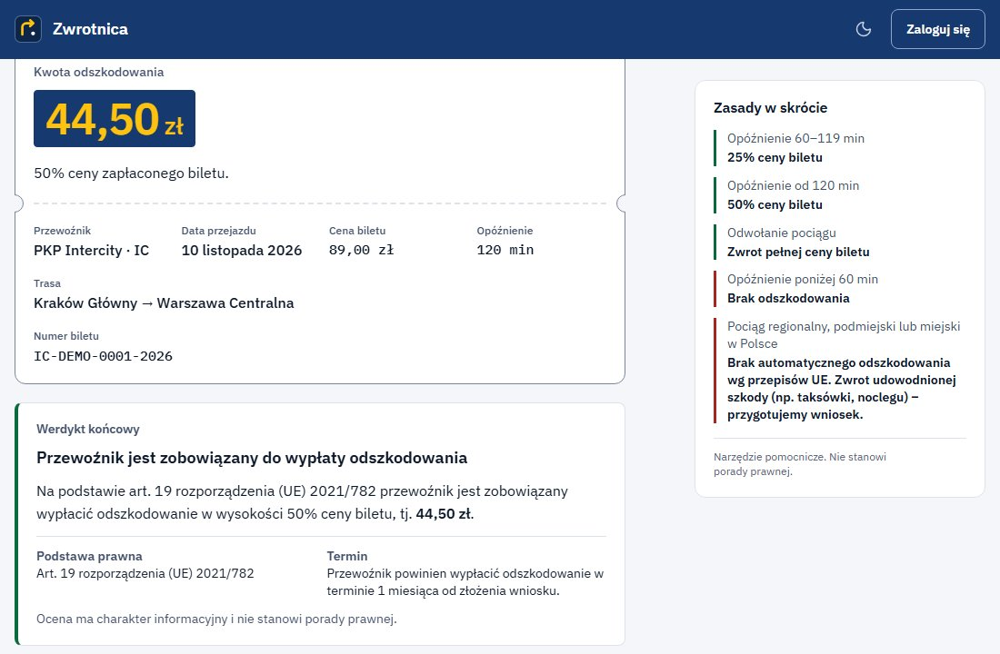
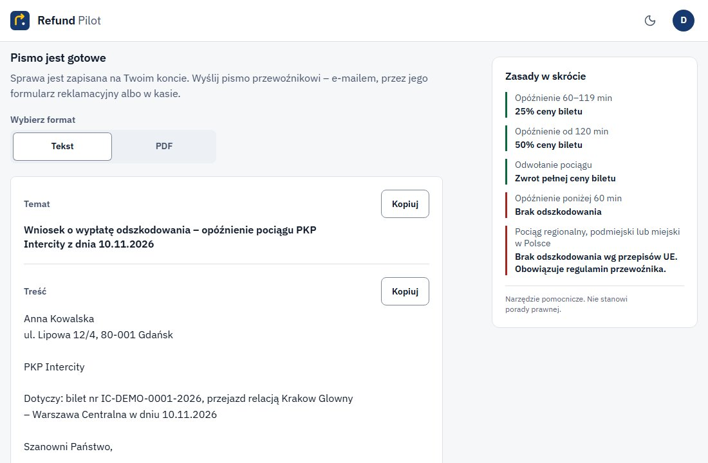

# Zwrotnica

Aplikacja, która mówi uczciwie, czy pasażerowi pociągu należy się odszkodowanie za opóźnienie, ile dokładnie, i przygotowuje gotowe pismo reklamacyjne.


| Strona główna | Werdykt końcowy | Pismo |
|---|---|---|
|  |  |  |

Więcej zrzutów (ciemny motyw, telefon): [`docs/screenshots/`](docs/screenshots/).

## Co to jest

Pociąg dalekobieżny spóźnił się ponad godzinę? Według rozporządzenia (UE) 2021/782 pasażerowi należy się 25% albo 50% ceny biletu, ale mało kto o tym wie i chce pisać reklamację. **Zwrotnica** w trzech krokach (Bilet → Opóźnienie → Wynik) ocenia sprawę, liczy kwotę i generuje pismo (tekst lub PDF). AI czyta bilet i pisze pismo, a o tym, co się należy, i o kwotach decyduje zwykły, przetestowany kod.

Demo online: **https://zwrotnica-d6a2hkftb7emcvc3.belgiumcentral-01.azurewebsites.net** (Azure App Service, darmowy plan – pierwsze wejście może potrwać kilkadziesiąt sekund). Konto demo działa online i lokalnie – dane w sekcji [Uruchomienie lokalne](#uruchomienie-lokalne), krok 5.

## Najważniejsze funkcje

- **Odczyt biletu przez AI** (zdjęcie lub PDF, do 4 plików po 5 MB), z oznaczeniem pól do uzupełnienia. Działa też ścieżka ręczna, bez klucza AI.
- **Uczciwy werdykt:** Należy się / Nie należy się / Do sprawdzenia, z uzasadnieniem. Pociągi regionalne i bilety okresowe nie dostają błędnej kwoty.
- **Kwoty:** 60-119 min to 25%, od 120 min 50%, odwołanie to zwrot 100% ceny. Ostrzeżenia o sile wyższej i minimalnej wypłacie (16 zł).
- **Werdykt końcowy** formalnym językiem: podstawa prawna, kwota, termin, zastrzeżenia.
- **Pismo reklamacyjne** jako tekst lub PDF, z listą danych do uzupełnienia. Aplikacja nigdy nie blokuje złożenia reklamacji (przy braku roszczenia z UE powstaje pismo wg regulaminu przewoźnika).
- **Przewoźnicy regionalni:** poza unijnym systemem 25%/50%, więc można wpisać poniesione koszty (np. taksówka, nocleg) i dostać wniosek o ich zwrot z listą załączników.
- **Co dalej po piśmie:** zweryfikowane linki do oficjalnych kanałów reklamacyjnych przewoźnika, termin odpowiedzi do kalendarza (.ics), a po terminie lub odmowie ponaglenie i skarga do Prezesa UTK z szablonu (tekst lub PDF).
- **Bezpieczeństwo:** sekcja o fałszywych SMS-ach „o odszkodowaniu” – Zwrotnica nie wypłaca pieniędzy i nigdy nie prosi o dane karty.
- **Trzy formy wypłaty:** zwrot na konto użyte do zakupu, inny rachunek, bon.
- **Konta i lista spraw:** statusy, licznik kwot, odliczanie miesiąca na odpowiedź przewoźnika, jedno przypomnienie e-mail po terminie. Numer rachunku jest szyfrowany w bazie.
- **Tryb gościa:** odczyt, werdykt i kwota bez logowania.
- **Mobile-first**, jasny i ciemny motyw.

## Jak działa AI

- AI **tylko** odczytuje dane z biletu i pisze treść pisma.
- Werdykt, kwoty i ryzyko odmowy liczy kod (`EligibilityService`, `CompensationCalculator`), zawsze od nowa po stronie serwera.
- Wyjście AI jest walidowane (JSON Schema, słownik przewoźników, kontrola treści pisma). Przy błędzie lub niezgodności pismo powstaje z szablonu.
- Dane osobowe z profilu nie trafiają do AI (model pisze tokeny, serwer je podmienia). Wyjątek: wgrane zdjęcie biletu.
- Bez klucza Gemini aplikacja działa w trybie ręcznym.

## Stack

| Warstwa | Technologie |
|---|---|
| Backend | ASP.NET Core (.NET 10), EF Core + SQLite, Identity, QuestPDF; warstwy Domain / Application / Infrastructure / Api |
| Frontend | React 19, Vite, TypeScript, zwykły CSS na tokenach, Vitest |
| AI | Google Gemini (structured output), `NullAiClient` bez klucza |
| CI/CD | GitHub Actions, Azure App Service |

Szczegóły (warstwy, diagram, decyzje, konfiguracja, API): [`docs/architektura.md`](docs/architektura.md).

## Uruchomienie lokalne

Wymagania: [.NET 10 SDK](https://dotnet.microsoft.com/download), [Node.js](https://nodejs.org/) 22.22+ (albo 24.15+ / 26), Git. Działa na Windows, macOS i Linux.

1. Sklonuj repozytorium:

   ```bash
   git clone https://github.com/TybBla/Zwrotnica-App.git zwrotnica
   cd zwrotnica
   ```

2. (Opcjonalnie) odczyt biletu przez AI: klucz z [Google AI Studio](https://aistudio.google.com/) (Get API key, darmowy poziom wystarczy). Skopiuj `.env.example` do `.env` (`cp .env.example .env` albo `Copy-Item .env.example .env`) i wpisz `GEMINI_API_KEY=twój_klucz`. API wczytuje `.env` samo. Bez klucza działa tryb ręczny.

3. Backend (API na **http://localhost:5080**, Swagger pod `/swagger`):

   ```bash
   dotnet run --project backend/src/RefundPilot.Api
   ```

4. Frontend, w drugim terminalu (**http://localhost:5173**, proxy `/api` do portu 5080, więc backend musi działać):

   ```bash
   cd frontend
   npm install
   npm run dev
   ```

5. Zaloguj się kontem demo (lokalne dane testowe z `appsettings.Development.json`, fikcyjna osoba i sprawy):

   | E-mail | Hasło |
   |---|---|
   | `demo@zwrotnica.test` | `Demo!2026pass` |

Można też założyć własne konto albo użyć kreatora jako gość. Po zmianie schematu usuń `backend/src/RefundPilot.Api/refundpilot.db*` (projekt używa `EnsureCreated` bez migracji). Opcjonalne ustawienia (model, limity, SMTP, przypomnienia): [tabela konfiguracji](docs/architektura.md#konfiguracja).

## Testy

```bash
dotnet test backend/RefundPilot.sln
npm --prefix frontend run test
```

Oba zestawy (oraz build i lint frontendu) uruchamia też GitHub Actions (`.github/workflows/ci.yml`). Testy backendu nie wywołują prawdziwego AI.

## Wdrożenie (Azure)

Jedna aplikacja Azure App Service (Linux, plan F1) serwuje API i zbudowany frontend z jednego adresu; wdrożenie robi GitHub Actions. Workflow `keep-alive.yml` co 10 minut odpytuje `/api/health`, żeby darmowy plan nie usypiał aplikacji. Instrukcja krok po kroku: [`docs/deploy-azure.md`](docs/deploy-azure.md).

## Jak korzystałem z narzędzi AI

Głównym narzędziem był **Claude Code** (Opus i Sonnet) z workflow „superpowers”:

1. **Brainstorming** zakresu MVP, potem **research** prawa i API Gemini ([`docs/research.md`](docs/research.md)).
2. **Wywiad ze mną:** agent pytał, ja decydowałem ([`docs/interview-decisions.md`](docs/interview-decisions.md)).
3. **Specyfikacja i plan** w [`docs/superpowers/`](docs/superpowers/plans/2026-11-13-refund-pilot.md).
4. **Subagent-driven development:** dla każdego zadania z planu świeży agent-implementer (TDD), potem niezależny agent-recenzent, pętla poprawek do czystej oceny. Widać to w historii commitów.
5. **Research projektowy:** pierwszy wygląd odrzuciłem jako generyczny, agent zbadał kierunek ([`docs/design-direction.md`](docs/design-direction.md)) i przeprojektował UI.

Konfiguracja agenta: [`instructions.md`](instructions.md) to regulamin (wymagania, zasady architektury, „AI tylko tam, gdzie reguły nie wystarczą”), [`skills-lock.json`](skills-lock.json) to zainstalowane umiejętności (m.in. `tdd`, `code-review`, `mobile-native`, `break-ui`). **Playwright** posłużył do nagrania dema i zrzutów ([`tools/demo/`](tools/demo/README.md)). **Gemini** wykorzystałem dodatkowo do własnego researchu (weryfikacja informacji i porównanie podejść), a w aplikacji działa jako model odczytujący bilet i piszący treść pisma.

**Podział ról:** decyzje produktowe (zakres, uczciwe werdykty, formy wypłaty, prawdziwe konta, szyfrowanie rachunku, kierunek wizualny, model biznesowy) podejmowałem ja. Kod wygenerowało AI pod moim nadzorem: oceniałem kolejne wersje (zwłaszcza wygląd i treści prawne), zgłaszałem uwagi i decydowałem o poprawkach.

## Ograniczenia

- Dane prawne częściowo ze źródeł wtórnych: przed realnym użyciem zweryfikować w tekście rozporządzenia i regulaminach przewoźników.
- Darmowy poziom Gemini może wykorzystywać przesłane treści do ulepszania usług (UI podpowiada, że dane osobowe na zdjęciu można zasłonić).
- SQLite i `EnsureCreated` bez migracji, jedna instancja; produkcyjnie potrzebne migracje i serwerowa baza.
- Brak weryfikacji e-maila i resetu hasła; klucze Data Protection są per maszyna.
- Poza zakresem: pozostałe prawa pasażera z rozporządzenia, autobusy i loty.

## Pomysły na rozwój

Z researchu rynku: aplikacje przewoźników pokazują opóźnienia, ale nie składają wniosków, PKP PLK nie udostępnia otwartego API z opóźnieniami, a fałszywe SMS-y „o odszkodowaniu” podkopują zaufanie do tej kategorii usług.

- **Najbliżej:** faktycznie otrzymana kwota przy statusie „Wypłacona” (realnie odzyskane vs wyliczone), zapisywanie wygenerowanego pisma w sprawie, dołączanie zdjęcia biletu do PDF.
- **Funkcje:** podróże z przesiadkami na jednym bilecie, pozostałe prawa pasażera (posiłki, nocleg, przekierowanie), PWA z powiadomieniami push, wersja angielska dla podróżnych zagranicznych.
- **Z partnerami:** automatyczna weryfikacja opóźnienia z danych PKP PLK („Twój pociąg spóźnił się 95 min – złóż wniosek”), moduł B2B / API dla aplikacji biletowych i banków, statystyki punktualności przewoźników z danych UTK.
- **Produkcyjnie:** migracje EF Core i PostgreSQL, klucze Data Protection w Key Vault, Application Insights, testy E2E Playwright i audyt dostępności w CI, weryfikacja e-maila i reset hasła, limit odczytów AI per konto.

## Dokumentacja

- [`docs/architektura.md`](docs/architektura.md): architektura, konfiguracja, API, struktura repo
- [`docs/deploy-azure.md`](docs/deploy-azure.md): wdrożenie na Azure
- [`docs/product-notes.md`](docs/product-notes.md): notatki biznesowe i kierunki rozwoju
- [`docs/design-direction.md`](docs/design-direction.md): kierunek wizualny
- [`docs/superpowers/`](docs/superpowers/specs/2026-11-13-refund-pilot-design.md): specyfikacja i plan implementacji

## Zastrzeżenie prawne

Narzędzie pomocnicze – nie stanowi porady prawnej. Werdykt i kwota wynikają z uproszczonych reguł. O wypłacie decyduje przewoźnik.
